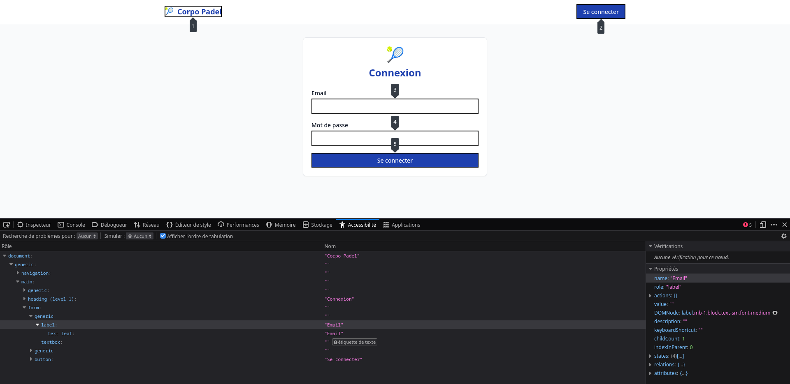

# ANO-002 — Libellés visibles des champs non reliés aux champs de saisie

| Champ | Valeur |
|---|---|
| **ID** | ANO-002 |
| **Type** | IHM (accessibilité) |
| **Sévérité** | Majeur |
| **Module** | Tous les formulaires ayant un libellé visible : `/login` (2 champs), `/profile` (5), `/change-password` (3), `/matches` — création de match (5) |
| **Environnement** | Firefox 160.0.1, Linux, commit `a0d25ca` |
| **Test associé** | TSP44 (exigence SP44 — WCAG 2.1 critères 1.3.1, 3.3.2, 4.1.2), constaté pendant TSP51-01 ; impacte TSP59 |
| **Pré-requis** | Visiteur non connecté (pour `/login`) |

## Étapes de reproduction
1. Ouvrir http://localhost:5173/login.
2. Outils de développement → onglet **Accessibilité**.
3. Déplier `main` → `form` → `generic` et sélectionner le nœud `textbox` du champ Email.

## Résultat attendu
Chaque champ possède un **nom accessible** égal à son libellé visible (« Email », « Mot de passe »),
via un `<label for="…">` relié à l'`id` du champ. Un lecteur d'écran annonce
« Email, zone de saisie ».

## Résultat obtenu
Le nœud `textbox` a un nom **vide** (`""`) et Firefox signale l'avertissement
**« étiquette de texte »**. Le texte « Email » est un `<label>` sans attribut `for` et le champ
n'a pas d'`id` : un lecteur d'écran annonce seulement « zone de saisie ». Même constat pour
« Mot de passe ».

Le code source confirme le même schéma (`<label>` sans `for`, champ sans `id`, aucun
`aria-label`) sur **15 champs** : `LoginView.vue` (2), `ProfileView.vue` (5),
`ChangePasswordView.vue` (3), `MatchesView.vue` formulaire de création (5).

## Preuve

## Correction suggérée
Relier chaque libellé à son champ, par exemple dans `LoginView.vue` :
`<label for="login-email" …>Email</label>` + `<input id="login-email" …>`.
Même correction dans les autres vues.
